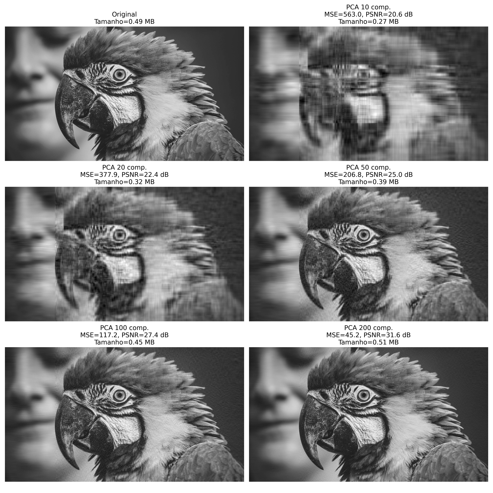
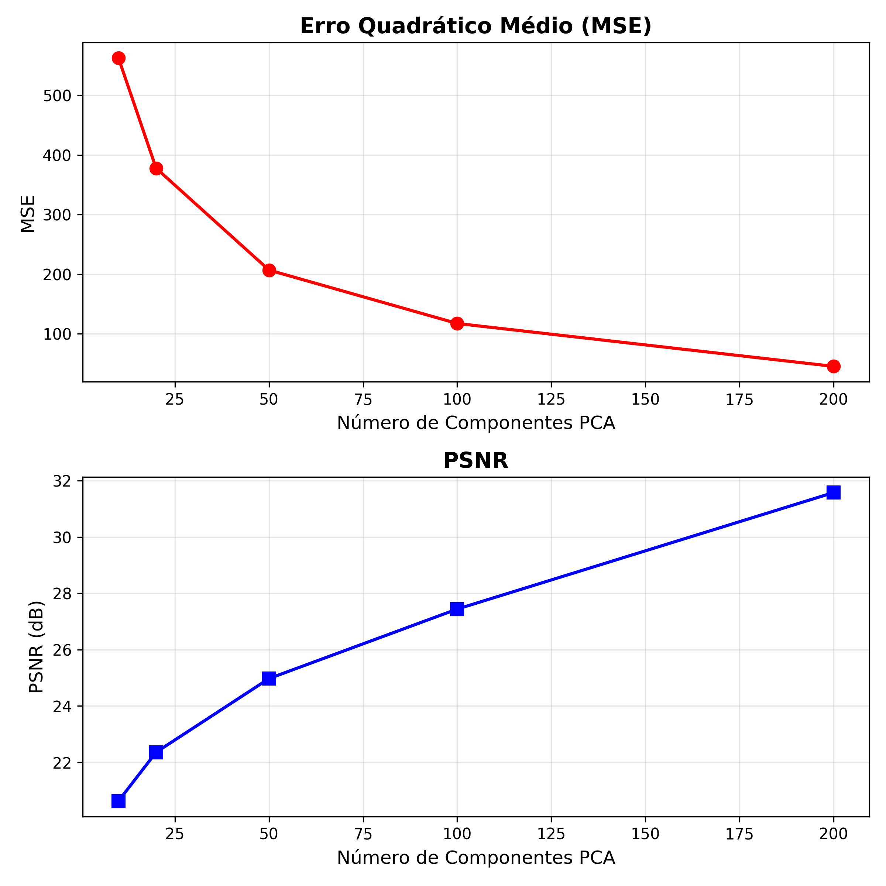
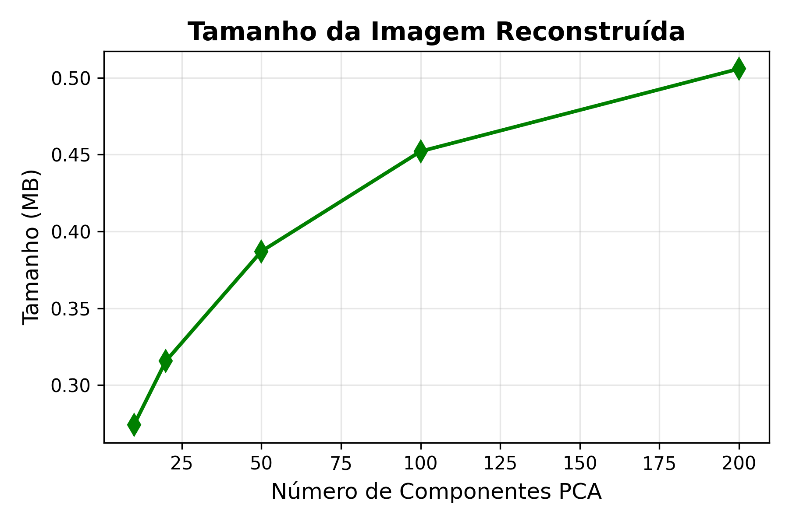

# Compressão e reconstrução de imagens com PCA

---

Este projeto demonstra a aplicação da **Análise de Componentes Principais (PCA)** para compressão e **reconstrução de imagens em escala de cinza**, avaliando a qualidade das reconstruções por meio de métricas como **MSE (Erro Quadrático Médio)**, **PSNR (Relação Sinal-Ruído de Pico)** e **tamanho em MB** das imagens resultantes.

<h1>Imagem Original</h1>

A aplicação do PCA em imagens reduz a dimensionalidade dos dados, preservando as características visuais mais relevantes. Esse processo permite a compressão da imagem, observando os seguinte trade-offs;
* com poucos componentes principais, obtém-se uma reconstrução mais aproximada, porém com perda de detalhes;
* com mais componentes, a qualidade visual melhora, mas o tamanho do arquivo também aumenta.

* Com 10 componentes: há perda significativa de detalhes e aparência borrada, mas a estrutura geral da imagem ainda é reconhecível.
* Com 20 a 50 componentes: a definição melhora e elementos menores tornam-se mais nítidos.
* Com 100 e 200 componentes: a reconstrução aproxima-se fortemente da imagem original, preservando quase todos os detalhes, embora com aumento no tamanho do arquivo.

Erro Quadrático Médio (MSE) diminui à medida que o número de componentes utilizados na reconstrução aumenta. Esse comportamento indica que a imagem reconstruída torna-se mais fiel à original, com menor discrepância entre os pixels correspondentes. Paralelamente, a Relação Sinal-Ruído de Pico (PSNR) cresce com o acréscimo de componentes, refletindo uma melhora perceptível na qualidade visual.

Em conjunto, esses resultados demonstram que o aumento no número de componentes reduz o erro quantitativo e aprimora a qualidade perceptual, evidenciando a eficácia do PCA na preservação das características essenciais da imagem original.

O tamanho do arquivo, medido em megabytes, também tende a aumentar com o número de componentes, destacando o trade-off entre compressão e fidelidade visual.
Enquanto a inclusão de mais componentes melhora a reconstrução e a qualidade perceptual, ela também eleva o volume de dados necessário para armazenamento. Assim, a otimização do processo requer um equilíbrio cuidadoso entre eficiência de compressão e preservação das características visuais da imagem original.

